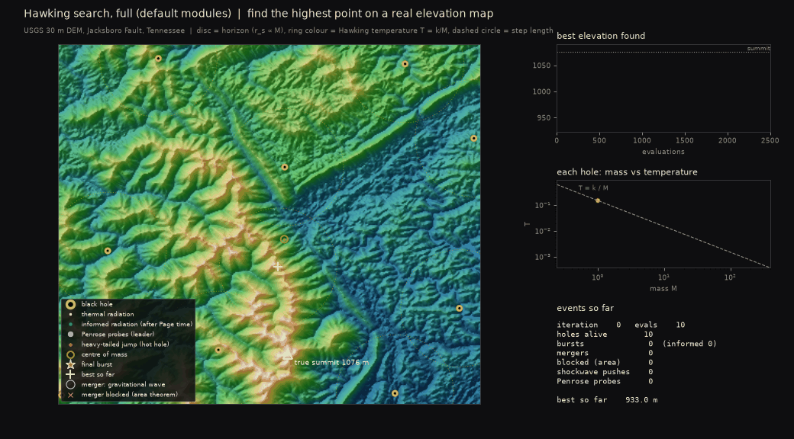
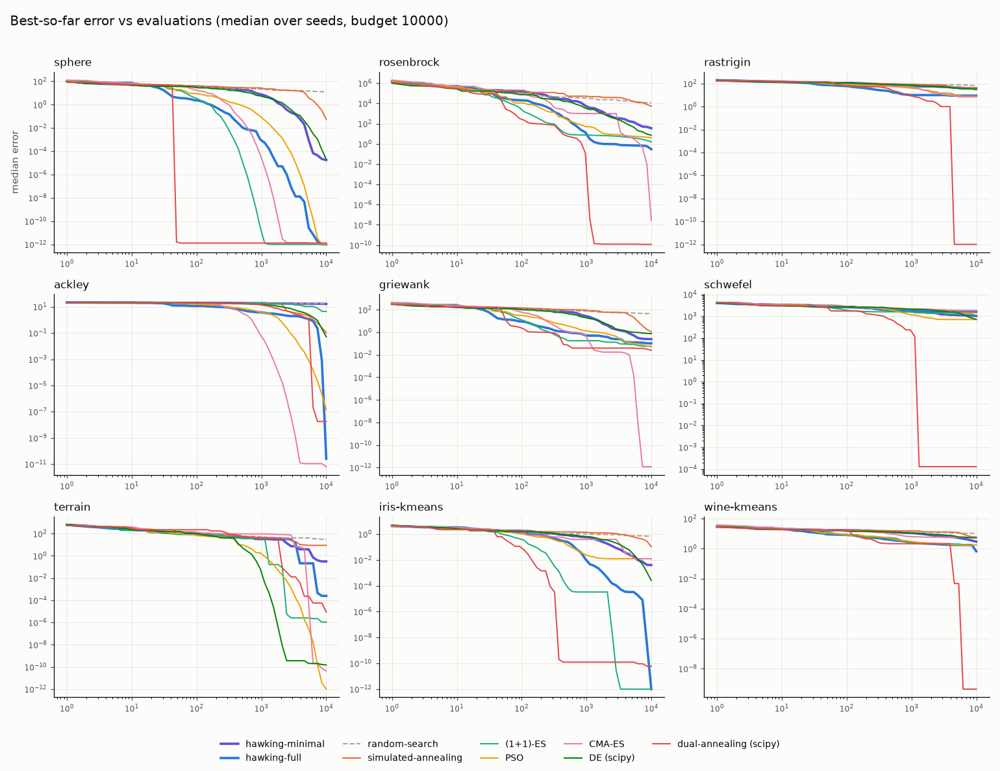
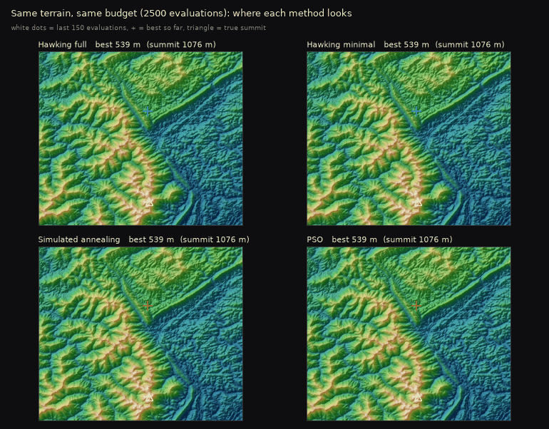
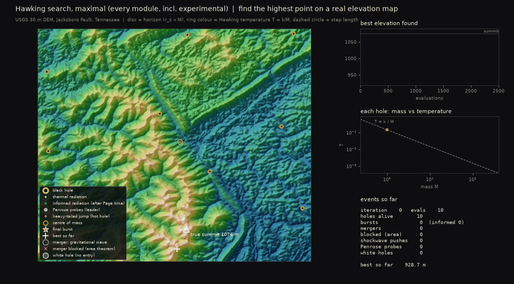
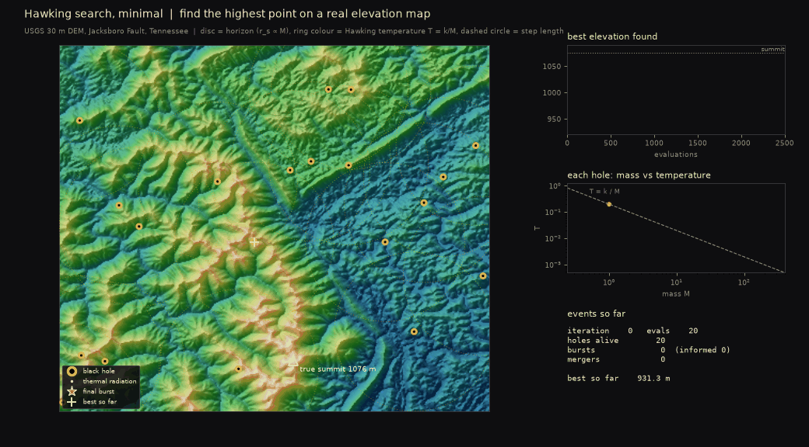

# Hawking search

A metaheuristic in which every candidate solution is a black hole. Mass is the
algorithm's currency: improving makes a hole heavier and colder, stagnating makes it
evaporate, and evaporation makes it hotter, so a stuck hole reheats itself into more
and more desperate exploration until it explodes into new holes. Nothing is
scheduled. Cooling and reheating emerge from the evaporation physics, one temperature
per hole.



*Full version searching for the highest summit on a USGS elevation model of the
Jacksboro Fault, Tennessee (72 local summits). Black discs are horizons (r_s ∝ M).
Ring colour is the Hawking temperature T = k/M. Violet dots are the leader's Penrose
probes, and the amber ring is the population's centre of mass. Blue rings are
gravitational waves, and red crosses are mergers the area theorem forbade. In the
last 20% of the budget ("ENDGAME") only the leader moves. This run (seed 6) reaches
the summit; at this short budget (2,500 evaluations) about half the runs do.*

> **Paper.** [*Hawking Cooling: Per-Searcher Step-Size Control from Black-Hole
> Evaporation, and a Controlled Test of Whether It Helps*](paper/hawking_cooling.pdf)
> isolates the core cooling rule and compares it against matched controls. The
> result is negative: a per-searcher 1/5 success rule beats it on eight of nine
> problems, because tying mass to accumulated improvement puts a floor under each
> searcher's step size. The module ablation below shows that the full optimiser
> gets its precision mainly from its local-search (Penrose) module. Reproduction steps are in
> [paper/README.md](paper/README.md).

## Three configurations

| | how to get it | what it contains |
|---|---|---|
| **Minimal** | [minimal.py](hawkingsearch/minimal.py) | The core loop of the original design: Hawking temperature, accretion, evaporation with runaway, final burst, mergers. ~140 lines. |
| **Full** (default) | `minimize_full(...)` | Core plus the original modules (gravitational waves, area theorem, Page curve, spin, spaghettification), plus gravity, the Penrose process and seven refinements described below. |
| **Maximal** | `FullConfig.maximal()` | Everything, including two experimental modules (slingshot, white holes) that didn't help. |

```python
from hawkingsearch import minimize_full, minimize_minimal, FullConfig, problems

p = problems.rastrigin(10)
res = minimize_full(p.f, p.lower, p.upper, budget=10_000, seed=0)
print(res.f, res.x)

minimize_full(p.f, p.lower, p.upper, config=FullConfig.ablate("page_curve", "spin"))   # modules off
minimize_full(p.f, p.lower, p.upper, config=FullConfig(white_holes=True))              # opt-in on
minimize_full(p.f, p.lower, p.upper, config=FullConfig.maximal())                      # everything
```

## The physics, as implemented

**Core** (both versions):

| Physics | Algorithm |
|---|---|
| Mass M | Accumulated improvement. `M += gain * improvement / scale` on success. |
| Hawking temperature T = k/M | Mutation step length (in unit-cube units). |
| Evaporation dM/dt = −α/M² | On failure, `M -= dt * α / M²`, where dt counts iterations since the last success. |
| Negative heat capacity | Losing mass raises T, which lowers the success rate, which speeds up mass loss: the runaway. |
| Final burst | At `M < M_min` the hole is replaced by up to 3 light holes around its last position. |
| Merger | Horizons overlap (`dist < r_s(a) + r_s(b)`, r_s ∝ M) → one hole at the better position. |

**Modules** (full version; all on by default unless marked):

| Module | Algorithm |
|---|---|
| Gravity | Candidates drift toward heavier, better holes with a = GM/r². |
| Gravitational waves | A merger radiates 5% of the mass as a shockwave that pushes nearby light holes outward. |
| ↳ *diversity-aware* | Shock strength × exp(−spread / 0.05): strong once the population has bunched up, faint while it's spread out. |
| Area theorem | A merger must not shrink Σ M². With 5% radiated, mergers more lopsided than ~18:1 are forbidden. |
| Page curve | Once a hole has lost half its peak mass, its mutations follow the covariance of the points it accreted, and its burst children are sampled from that distribution (and inherit its mass). |
| Spin | Holes spin up from curved accretion paths and from mergers (equal masses → χ ≈ 0.69, as in GR). Heavy spinning holes rotate nearby candidates around themselves. |
| Spaghettification | Near a heavier hole, mutations are stretched along the line to it and squeezed across it (volume-preserving). |
| **Penrose process** | The leader, if heavy and spinning, probes `x±δ`, fits a parabola through the three values, and evaluates its minimum: a 1-D Newton step. |
| ↳ *learned directions* | δ follows the covariance of the leader's accreted points (the Page-curve directions) instead of a random direction. |
| ↳ *adaptive step* | The probe distance grows ×1.5 on success and shrinks ×0.6 on failure, like a trust region. |
| **Endgame** | In the last 20% of the budget, only the leader moves, every step is a Penrose step, and it doesn't evaporate. |
| **Galactic centre** | Every non-leader hole drifts 25% of the way toward the population's mass-weighted centre each step. |
| **Lévy radiation** | Holes lighter than M = 1 take heavy-tailed (Cauchy-length) jumps: the high-energy tail of a nearly evaporated hole. |
| **CMB spawning** | New random holes are placed at the emptiest of 16 random proposals (farthest from all recent evaluations). |
| *Slingshot* (off) | Holes keep 25% of a successful step as velocity. |
| *White holes* (off) | A hole dying in a worse-than-best basin leaves a no-entry zone there for 150 iterations. |

### Where I departed from the original design, and why

Each of these came from watching the original rules fail in a specific way. All are
switches or config values, so the original behaviour is one flag away.

1. **Gravity was added as a module.** The spin module's wording ("orbit the optimum
   instead of falling straight in") assumes holes fall toward each other. Without
   it, the holes are independent local searches.
2. **Gravity only pulls downhill**, toward holes that are heavier *and* better.
3. **dt in the evaporation is a starvation clock** (iterations since last success).
   With dt = 1, lifetime grows as M³, so holes that grew a little early never died,
   and bursts and the Page curve never fired.
4. **Merger radiation is a flat 5%**, as in the original design. Scaling it with the mass ratio
   makes the area theorem impossible to violate.
5. **Shockwaves cost no evaluations.** A pushed hole's next move is simply accepted.
6. **Only the leader runs the Penrose process.** With every heavy hole running it,
   97% of the budget went to refinement and exploration collapsed.
7. **Practical clamps:** horizon radius saturates, mass gain per step is at most a
   doubling, and new holes appear if mergers shrink the population below half.

## Results

Same budget for everyone (10,000 evaluations, counted by one shared wrapper), 15
seeds, 9 problems. Three use real data: the elevation map, and k-means clustering
of the Iris (12 variables) and Wine (39 variables) datasets from scikit-learn.
Errors are `f − f_opt`, so lower is better. Full table: [results/summary.md](results/summary.md).

| algorithm | sphere | rosenbrock | rastrigin | ackley | griewank | schwefel | terrain (m) | iris | wine | mean rank |
|---|---|---|---|---|---|---|---|---|---|---|
| dual annealing (scipy) | 3.0e-13 | 1.2e-10 | 2.8e-14 | 1.8e-8 | 0.025 | 1.3e-4 | 9e-6 | 5.9e-11 | 4.3e-10 | 2.44 |
| PSO | 9.5e-17 | 4.12 | 7.96 | 1.4e-7 | 0.057 | 711 | 0 | 0.012 | 1.71 | 3.22 |
| **hawking-full** | **7.2e-23** | 0.299 | 8.95 | **2.5e-11** | 0.103 | 1620 | 2.5e-4 | 1.7e-15 | 0.664 | **3.56** |
| CMA-ES | 2.0e-13 | 2.7e-8 | 6.96 | 5.4e-12 | 1.8e-13 | 1850 | 4e-11 | 0.012 | 5.73 | 3.89 |
| (1+1)-ES | 4.6e-16 | 1.58 | 33.8 | 4.42 | 0.057 | 1090 | 1e-6 | 1.6e-15 | 1.73 | 4.22 |
| DE (scipy) | 2.0e-5 | 7.26 | 30.3 | 0.052 | 0.750 | 712 | 1e-10 | 2.6e-4 | 5.22 | 5.11 |
| **hawking-minimal** | 1.7e-5 | 35.5 | 37.4 | 16.4 | 0.245 | 1030 | 0.31 | 4.0e-3 | 2.90 | 6.11 |
| simulated annealing | 0.053 | 5320 | 43.8 | 0.105 | 1.11 | 1460 | 8.72 | 0.104 | 5.96 | 7.56 |
| random search | 12.8 | 11700 | 69.0 | 16.9 | 45.1 | 1840 | 29.5 | 0.695 | 10.1 | 8.89 |

Hawking full vs each method, counting problems where the difference is significant
(Mann-Whitney U, p < 0.05):

| opponent | Hawking full better | no difference | Hawking full worse |
|---|---|---|---|
| random search | **9** | 0 | 0 |
| Hawking minimal | **8** | 0 | 1 (schwefel) |
| simulated annealing | **8** | 1 | 0 |
| DE | **7** | 0 | 2 |
| (1+1)-ES | 3 (rosenbrock, rastrigin, ackley) | 5 | 1 |
| PSO | 3 (rosenbrock, ackley, iris) | 4 | 2 |
| CMA-ES | 2 (iris, wine) | 4 | 3 |
| dual annealing | 1 (ackley) | 3 | 5 |



**Takeaways:**

- **It's a competitive optimiser now.** It ranks 3rd of 9, ahead of CMA-ES. It beats
  random search, simulated annealing, DE and its own minimal version almost
  everywhere. On Ackley it beats even dual annealing. It still clearly loses to
  dual annealing overall.
- **Best results:** sphere (7e-23, the best of all methods), Ackley (2.5e-11), Iris
  (1.7e-15). The leader's Penrose steps, with an adaptive step and the endgame, are
  what drives precision.
- **Weak spots:** Schwefel (deceptive, with the best basin far from the second best:
  the centre-of-mass pull drags holes the wrong way) and Rastrigin (it ends one or
  two local minima short, error 8.95 vs dual annealing's ~0).
- **Wine and terrain are bimodal.** Runs either land essentially on the optimum or get
  stuck in one specific local optimum (Wine: about 0.66; terrain: a 1,040 m summit).
  So medians jump around between variants without the differences being significant.
- **The minimal version is no better than random search on Ackley**: the flat plateau
  gives independent local searches nothing to follow.

### How the defaults were chosen (and kept honest)

The reported benchmark uses seeds 0–14. Everything was decided on other seeds:

1. Each new mechanism was screened alone and in leave-one-out combinations on
   seeds 100–119.
2. Eleven parameters were tuned by random search (40 settings) on seeds 200–205.
   The best five were re-checked on seeds 100–119, and the winner was adopted
   (mean log₁₀ error −3.23 → −3.60).

The problems themselves were not held out: tuning and reporting use the same 9
problems. Expect some optimism on these 9 compared with new ones.

### Which modules matter (ablation)

Each row switches one module relative to the default, with the same 15 seeds and
budget. Only significant differences (p < 0.05) are listed. Full table:
[results/ablation.md](results/ablation.md).

| change | significantly worse on | significantly better on |
|---|---|---|
| without Penrose | sphere (7e-23 → 4e-5), rosenbrock, ackley, griewank, terrain, iris | — |
| without galactic centre | rastrigin (9 → 38), ackley | schwefel |
| without Penrose learned directions | rosenbrock, griewank | — |
| without spin (disables Penrose) | ackley, griewank | — |
| without gravitational waves | ackley, griewank | — |
| without gravity | ackley | — |
| without endgame | ackley | — |
| without adaptive Penrose step | ackley | — |
| without diversity-aware shocks | ackley | — |
| without area theorem | ackley | — |
| without spaghettification | terrain | — |
| without Page curve | — | iris |
| without Lévy radiation | — | — |
| without CMB spawning | — | — |
| with slingshot / with white holes | — | — |
| no modules at all | 7 of 9 | schwefel |

- **The Penrose process is now the most important module.** The galactic centre is
  second.
- **Ackley is where the parts interlock.** Removing almost any one module breaks it
  (2.5e-11 → anywhere from 1.5e-5 to 2.6), which is why the full combination solves it.
- **Lévy radiation and CMB spawning show no measurable effect** at 15 seeds, though
  they were part of the combination that won screening on Ackley. They're kept on
  but could be dropped with little loss.
- **The Page curve is still the weakest of the original modules.** It fires and now
  supplies the Penrose directions, but switching off the Page-curve *mutations* is
  slightly better on Iris.

### What was tried along the way

| Round | Change | Outcome |
|---|---|---|
| 1 | Gravity, downhill rule, starvation clock, flat 5% radiation | Made the original modules work at all |
| 2 | **Penrose process** (leader only) | Broke the precision cap (sphere 5e-4 → 1e-9) |
| 2 | Slingshot | Hurt Ackley and Griewank → off |
| 2 | White holes | Neutral when small; large ones blocked Rosenbrock's valley (7.9 → 118) → off |
| 3 | Penrose learned directions + adaptive step, endgame, galactic centre, Lévy radiation, CMB spawning, diversity-aware shocks | Ackley 1.7 → 2.5e-11, Rosenbrock 5.5 → 0.3, terrain 0.13 → 0.0002 m, Iris 3e-7 → 2e-15; worse on Schwefel (1140 → 1620) and Wine (median 0.20 → 0.66, bimodal) |
| 3 | Re-tuning (smaller population, colder start, slower evaporation, stronger gravity) | Mean log error −3.23 → −3.60 on validation seeds |

## Optional curvature refinement and exploration experiments

The original defaults and the results above are preserved. Three new opt-in
modules can be compared with them:

```python
cfg = FullConfig(ringdown=True, ringdown_endgame_only=True)
res = minimize_full(p.f, p.lower, p.upper, budget=10_000, seed=0, config=cfg)

# Independent exploration experiments; combinations need their own comparison.
cfg = FullConfig(hawking_quanta=True)
cfg = FullConfig(local_centre=True)
```

**Ringdown** extends the Penrose process from independent one-dimensional
parabolas to coupled local curvature. A leader eligible for Penrose refinement
measures slopes with paired probes, initializes an inverse curvature tensor,
and updates it with positive-curvature BFGS secants. The search direction is
`-H @ gradient`, bounded initially by its horizon/temperature scale; a dissipative
line search reduces the step until it improves the objective. This can create
the rapid basin refinement seen in dual annealing. The implementation uses
NumPy directly and requires no supplied gradients.

The connection to black-hole relaxation is an **analogy**. The BFGS update is a
numerical optimization method, not a law of black-hole physics. Ringdown measures
the objective's local potential rather than integrating spacetime perturbations.

All probes count against the shared budget. `ringdown_fraction=0.25` caps their
total allocation, and `ringdown_evals_per_dim=80` caps each episode. Episodes
require a cooldown and a changed or improved leader; normal exploration and
Penrose steps continue outside them. At a box wall, probes become one-sided.
Ringdown is skipped while white-hole exclusion zones exist, since repelling a
probe would invalidate the local slope estimate. The dense curvature matrix
costs O(d²) memory and a central gradient costs 2d evaluations, so this extension
is intended for modest-dimensional, reasonably smooth objectives.

`ringdown_endgame_only=True` defers this relaxation to the existing endgame,
preserving the original exploration trajectory before that phase. Omitting it
allows early sharp drops, but early commitment can hurt exploration on Ackley.

**Single-quantum radiation** (`hawking_quanta`) excites one coordinate per thermal
or Lévy emission and preserves the expected squared mutation length before
external forces and boundary handling. It can preserve already-good coordinates
while another crosses a barrier. It uses the supplied coordinate axes, so benefits
on separable functions need not transfer to rotated landscapes. Informed
Page-curve radiation and Penrose probes keep their existing directions.

**Local galactic centres** (`local_centre`) restrict the centre pull to better
holes within their tidal influence radii. This preserves distant basins but can
also weaken the collective convergence that helps on Rastrigin.

The [refinement study](results/refinement-notes.md) records screening and fresh-seed
validation, including convergence plots, raw runs and limitations. Reproduce it
without overwriting the original benchmark:

```bash
python -m hawkingsearch.refinement_study --seed-start 500 --seeds 15 --variants original ringdown late-ringdown late-ringdown+quanta 'dual-annealing (scipy)' --reference late-ringdown --out results/late-ringdown-validation
```

## Animations

| | |
|---|---|
|  | **Race** ([media/race.gif](media/race.gif)): four methods on the same terrain, budget and seed. White dots are the last 150 evaluations. |
|  | **Maximal** ([media/hawking_maximal.gif](media/hawking_maximal.gif)): every module, including slingshot and white holes (translucent white discs). This run (seed 1) ends on a 1,067 m summit, not the top. |
|  | **Minimal** ([media/hawking_minimal.gif](media/hawking_minimal.gif)): no gravity, so holes wander independently. |

```bash
python -m hawkingsearch.animate                      # full version  -> hawking_full.gif
python -m hawkingsearch.animate --variant maximal    # incl. slingshot + white holes
python -m hawkingsearch.animate --variant minimal
python -m hawkingsearch.animate --race
python -m hawkingsearch.animate --seed 0 --budget 4000 --out my.gif
```

## Running it

```bash
python -m venv .venv
.venv/Scripts/activate           # Windows; on macOS/Linux: source .venv/bin/activate
pip install -e ".[test]"

pytest                                            # 94 tests, ~30 s
python -m hawkingsearch.benchmark                 # full comparison, ~70 s on 12 cores
python -m hawkingsearch.benchmark --ablation      # module ablation, ~9 min
python -m hawkingsearch.benchmark --quick         # 5 seeds, 3,000 evaluations
```

### Tests

- [tests/test_physics.py](tests/test_physics.py): the formulas behave like the physics.
  Evaporation accelerates, the runaway happens, lifetime follows the M³ law, and the
  area theorem forbids >18:1 mergers. Also: remnant spin 0.69, frame dragging is a
  rotation, spaghettification preserves volume, white holes expel, and the Penrose
  parabola is exact on quadratics.
- [tests/test_algorithms.py](tests/test_algorithms.py): every algorithm uses exactly
  its budget, stays in bounds and is deterministic given a seed. Mass changes follow
  the rules.
- [tests/test_modules.py](tests/test_modules.py): inside real runs, mergers respect the
  area theorem, shockwaves push, and Page-curve children cluster. No candidate enters
  a white hole, and only the leader makes Penrose probes. The endgame gives every
  evaluation to the leader, CMB spawning spreads the population, and each module's
  events disappear when it is switched off.
- [tests/test_comparison.py](tests/test_comparison.py): statistical head-to-heads that
  pin down the claims above. They include honest ones: dual annealing still wins on
  Rastrigin, SA isn't beaten on Ackley at the smaller test budget, and the minimal
  version is lost on Ackley's plateau.

## Layout

```
hawkingsearch/
  minimal.py     core loop (the original design)
  full.py        core + all modules, physics as small pure functions
  baselines.py   random search, SA, (1+1)-ES, PSO, CMA-ES, DE, dual annealing
  problems.py    6 classic functions + terrain (USGS DEM) + Iris/Wine k-means
  core.py        shared evaluation budget wrapper
  benchmark.py   comparison + ablation runner, tables and charts
  animate.py     GIF animations on the elevation map
  ringdown.py    optional coupled-curvature (BFGS) refinement
  refinement_study.py   refinement and exploration experiments
tests/           physics, contract, module and comparison tests
results/         benchmark and study outputs (tables, CSV, charts, notes)
paper/           manuscript, its controlled experiment and reproduction guide
media/           animations
```

**Data sources:** the elevation model is `jacksboro_fault_dem.npz` from matplotlib's
sample data (USGS 30 m DEM). Iris and Wine come from `sklearn.datasets`; their
reference optima are the best of 50 k-means++ restarts.

**Note for Windows:** the benchmark uses `multiprocessing.Pool`, because
`concurrent.futures.ProcessPoolExecutor` intermittently crashed while starting
workers ("WinError 6: the handle is invalid").

## Licence and citation

The code is released under the [MIT licence](LICENSE). The manuscript in
[paper/](paper/) is licensed under [CC BY 4.0](paper/LICENSE.md).
If you use this software, please cite it using [CITATION.cff](CITATION.cff)
(GitHub's "Cite this repository" button).
